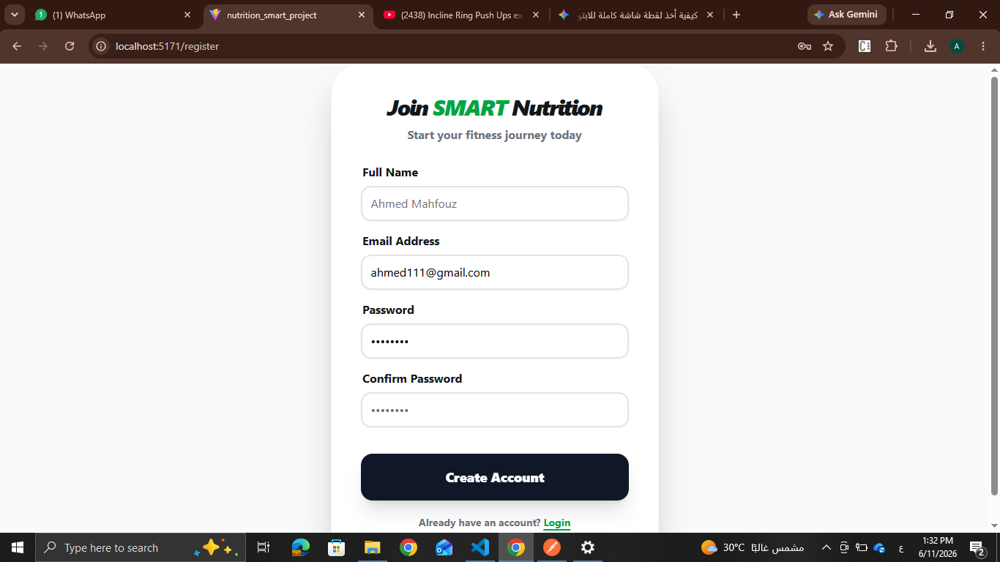
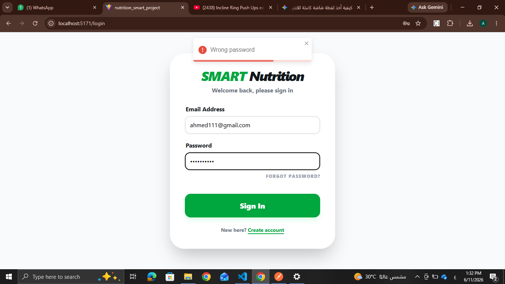
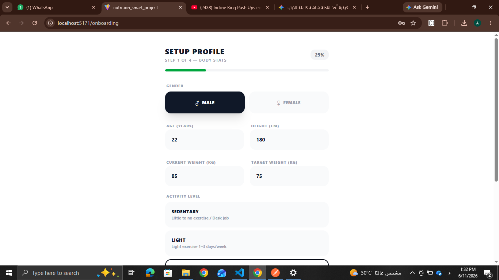
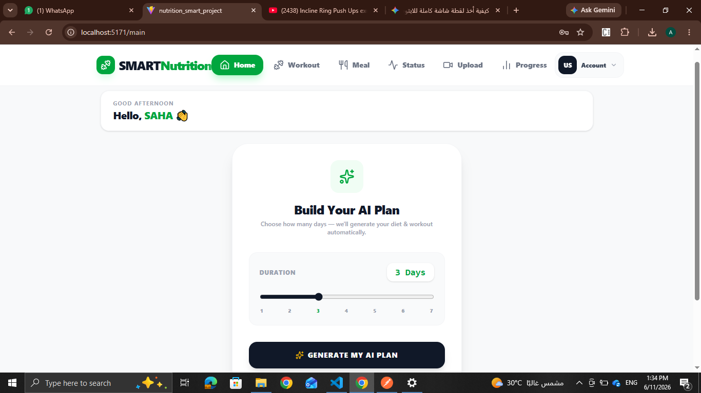
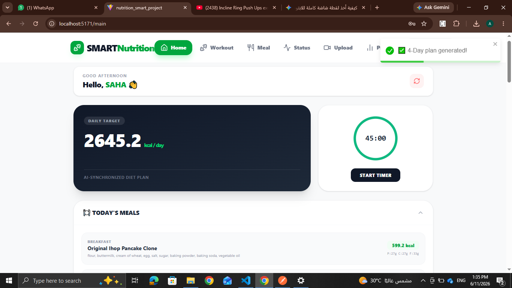
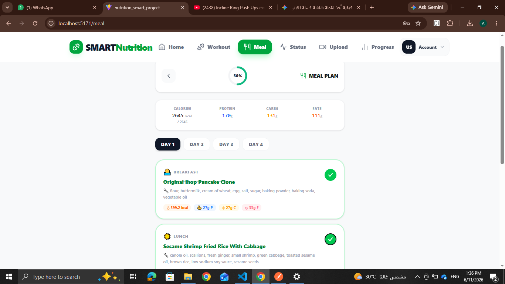
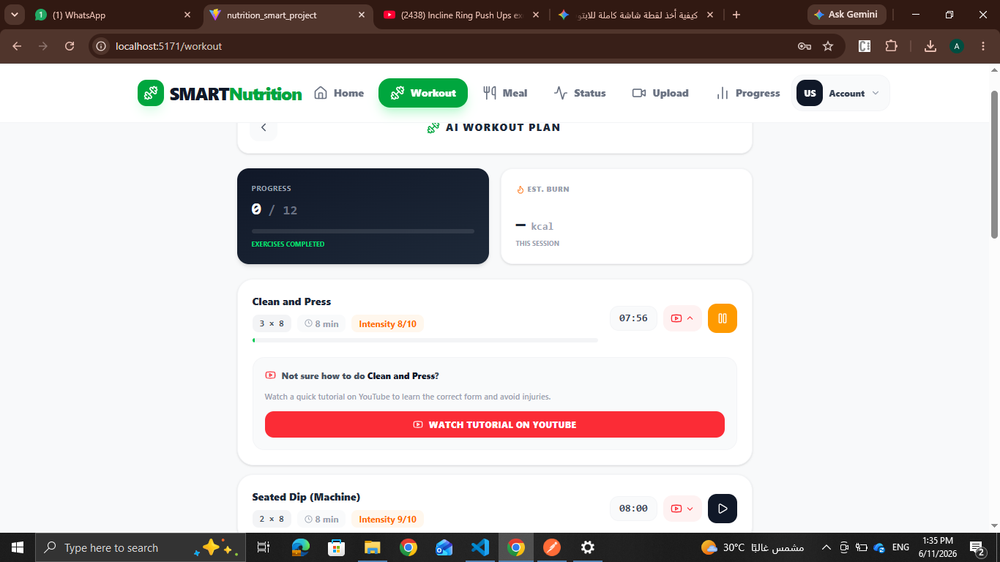
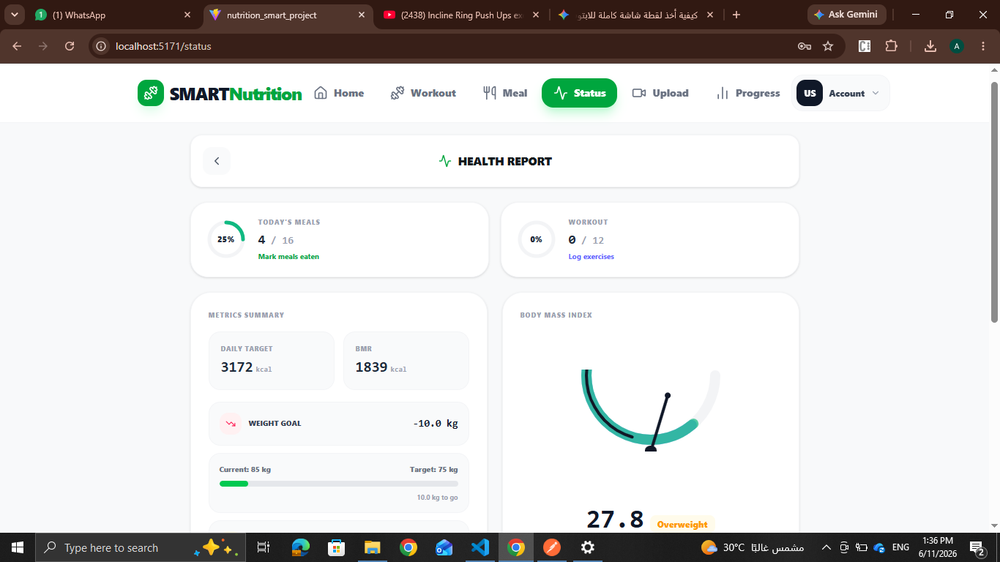
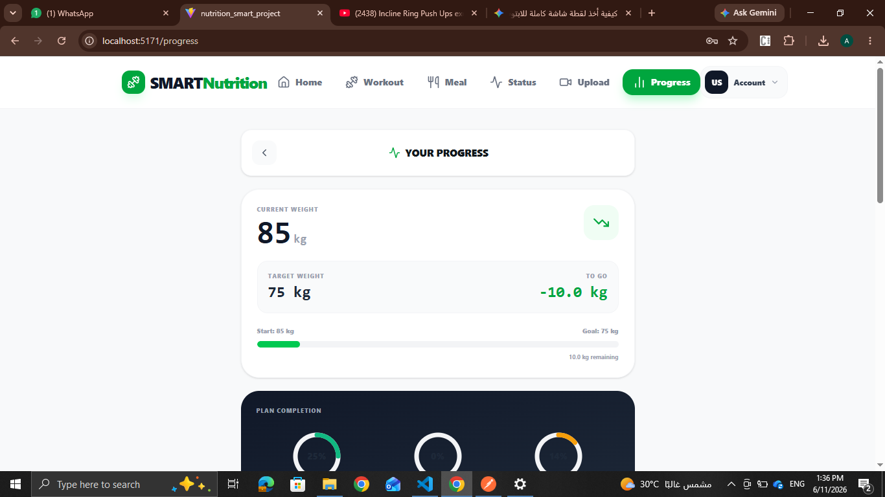
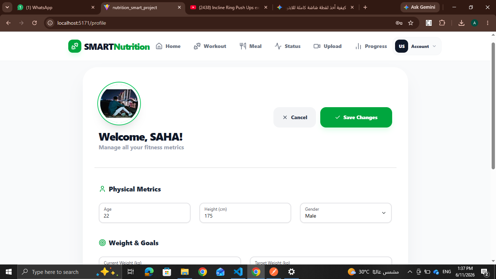

# SMART Nutrition (Vitaflow) – Web Frontend

A web app that generates AI-powered personalized meal and workout plans and tracks the user's progress. This is the React web frontend of our graduation project (Computer Science & AI, Faculty of Computers and Information, Benha University).

> **Note:** The backend APIs were hosted on a trial period and may no longer be online. The screenshots below show the app running with the live backend.

## My Role

I built the entire web frontend: all pages, routing, form validation, API integration, and UI/UX. The backend services and the AI models were developed by my teammates.

## Features

- **Authentication:** register, login, forgot password, and reset password with form validation.
- **Onboarding:** step-by-step profile setup (age, height, weight, target weight, activity level, fitness goal, experience level, equipment) with automatic BMR and daily-calorie estimation.
- **AI Plan Generation:** choose a plan duration and generate a personalized meal and workout plan.
- **Meal Plan:** view meals with calories and protein, and mark them as done.
- **Workout Plan:** exercises with sets, reps, timers, completion tracking, and tutorial links.
- **Status Dashboard:** BMI gauge with category, today's meals and workout, daily macro targets.
- **Progress Tracking:** current vs. target weight, plan completion, meal and workout breakdowns, nutrition targets.
- **Profile Management:** edit all fitness metrics.
- **Protected routes:** authenticated pages and onboarding checks.
- **Responsive design** with smooth animations.

## Screenshots

| Register | Login |
|---|---|
|  |  |

| Onboarding | Home |
|---|---|
|  |  |

| Generated Plan | Meals |
|---|---|
|  |  |

| Workout | Status |
|---|---|
|  |  |

| Progress | Edit Profile |
|---|---|
|  |  |


- React 19, React Router 7, Vite
- HeroUI, Tailwind CSS 4, Framer Motion, Lucide Icons
- React Hook Form + Zod (form validation)
- Axios (REST API calls), React Toastify
- JWT-based authentication (token sent with each request)

## Project Structure

```
src/
├── components/        # Navbar
├── contexts/          # Auth context
├── layouts/           # Auth and main layouts
├── pages/             # Landing, Login, Register, Onboarding, Main, Meal, Workout, Status, Progress, Profile ...
├── ProtectedRoutes/   # Route guards
├── schema/            # Zod validation schemas
├── services/          # API services
└── utils/             # Enum mappers for backend values
```

## Architecture

The frontend communicates with two backend services:
- an authentication and profile service (Node.js)
- a plan generation service (Spring Boot), which uses AI models for meal and workout recommendations

## Run Locally

```bash
git clone https://github.com/ahmedsaber2000w4-de/Smart-Nutrition-project.git
cd Smart-Nutrition-project
npm install
npm run dev
```

## Team

Graduation project built by a team of six, under the supervision of Prof. Wafaa Shalash and Eng. Esraa Taher.

## Author

**Ahmed Saber** – Frontend Developer
[LinkedIn](https://www.linkedin.com/in/ahmed-saber-69a6b8272/)